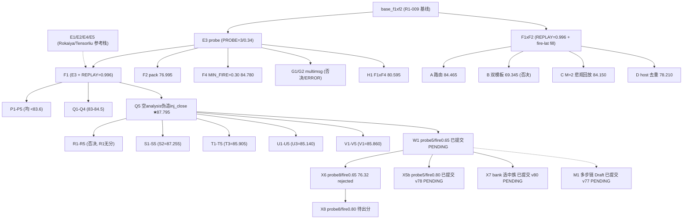

# Candidate DAG — JED 攻击变体分支树

> 基于各变体文件头与提交消息推断；未知/未提交的分支标注「未交」。



## 决策锚点

| 锚点 | 值 | 说明 |
|------|-----|------|
| 主锚点 | Q5 87.795 | 全队最高，所有后续分支的父 |
| 次锚点 | S2 87.255 | 微旋钮副线 |
| 当前枪 | x6=76.32 rejected；M1 / x5 / x8 / x7 待出分 | x6 判线已执行 → 回 W1 换桶 |
| 冻结线 | V5 84.780 | 已否决继续叠加（勿在 V 系上堆补丁） |

规则：分支独立演化，达门槛后才考虑与其它分支合并（crossover）；不许只在当前最高分上连续堆补丁。

## 分支线（多分支搜索，禁止所有实验同源）

| 分支线 | 代表候选 | 状态 |
|--------|----------|------|
| 稳健主线 | Q5 → W1（探针轴） | 活跃（W1 PENDING） |
| 微旋钮线 | S（0.33/0.995/body） | 收敛（0.34/0.996/空 body 最优） |
| 参考栈线 | E1-E5（Rokaiya/Tensorliu） | 冻结（只可移植单旋钮） |
| 结构线 | A-D/P2/G（路由/搜索结构/multimsg） | 冻结（EXP-007/009） |
| 多谓词线 | B/U4/d2 | 冻结（EXP-005，须 crossover 合同） |
| 高风险大改线 | （空） | 未启用；启用时须本地证据先行 |

## 父节点选择（不只贪最高分）

```text
优先级 = 稳健收益 − 验证不确定性惩罚 + 与现有方案差异性 + 未探索价值 − 运行成本 − 过拟合/回放风险
```

| 候选父 | 公榜 | 稳健性 | 差异性 | 判语 |
|--------|-----:|--------|--------|------|
| Q5 | 87.795 | 高（唯一锚点） | — | 默认父 |
| S2 | 87.255 | 中（单点差 0.54） | 低 | 微旋钮副线 |
| T3 | 85.905 | 中 | 低 | 已收敛，不推荐继续 |
| U3 | 85.140 | 中 | 低 | 参考线残留 |
| E2 | 85.770 | 中 | 中 | 可作单旋钮移植源 |
| V1 | 85.860 | 中 | 低 | 冻结 |

结论：下一父节点仍优先 Q5（除非 W1 公榜 ≥87.8 则 W1 成为新父）。
